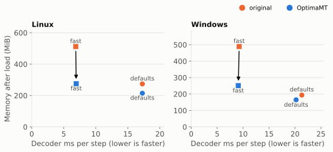
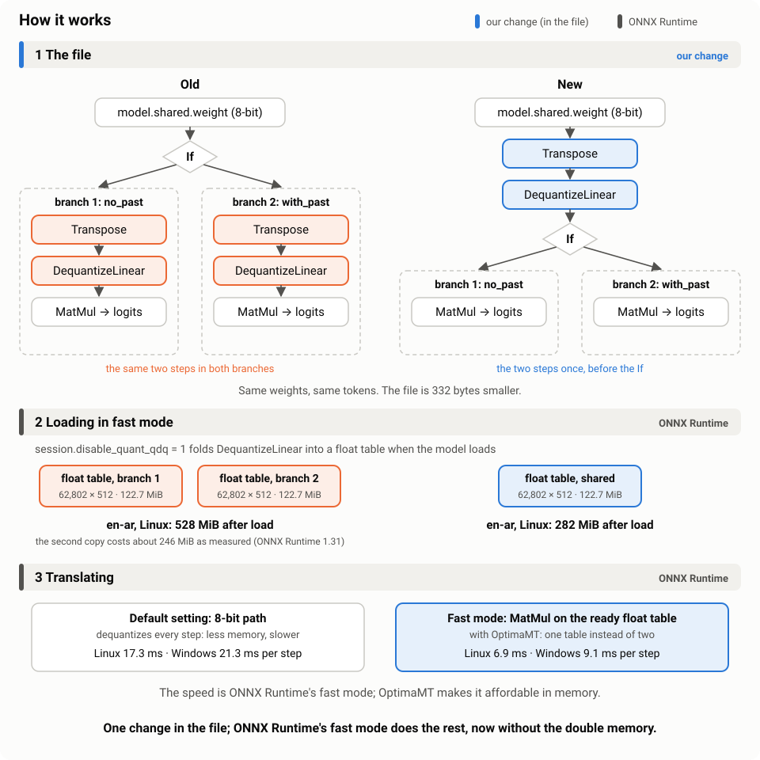
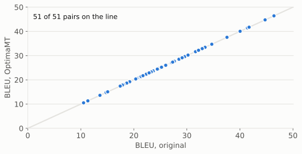

# OptimaMT

[](https://doi.org/10.5281/zenodo.24107401)     

**OptimaMT is a set of free translation models that run locally**, on your own computer or in the browser: 51
translation directions built from the University of Helsinki's OPUS-MT models and optimized for ONNX Runtime. Same
translations, about half the memory in fast mode, and a drop-in replacement: swap the model name and you're done.

**ONNX Runtime's fast mode at half the memory: 2.3–2.5× faster than the default, same translations.**

<p align="center"></p>

<sub>Fast mode used to cost double memory; OptimaMT keeps it fast and light. Medians of 5 reference pairs.</sub>

<p align="center"></p>

Same translations: on FLORES-200 devtest all 51 pairs give identical output, so identical BLEU.

<p align="center"></p>

Full technical report (PDF): [OptimaMT-Technical-Report.pdf](report/OptimaMT-Technical-Report.pdf) · more charts, the browser results and every number: [REPORT.md](REPORT.md) · interactive results and a live demo:
[OptimaMT/results](https://huggingface.co/spaces/OptimaMT/results)

## Used in production

- [OpenCircle](https://github.com/AmerAlreyahi/OpenCircle), a desktop screen translator for Windows and Linux, ships these models since v0.1.4.

## Quick start

```js
import { pipeline } from "@huggingface/transformers";

const translator = await pipeline("translation", "OptimaMT/de-en", {
  dtype: "q8",
  session_options: { extra: { session: { disable_quant_qdq: "1" } } }, // fast mode
});
const [out] = await translator("Der Leuchtturm steht an der Küste.");
console.log(out.translation_text); // The lighthouse is on the coast.
```

```bash
pip install onnxruntime sentencepiece numpy huggingface_hub
python scripts/translate.py OptimaMT/de-en "Der Leuchtturm steht an der Küste."
```

## Verify it yourself

```bash
pip install -r requirements.txt
python scripts/convert.py en-ar   # rebuilds the decoder from Xenova's file: byte-identical to ours
python scripts/verify.py en-ar    # same token ids as the original, both session settings
```

## Models

All 51 repos: [the OptimaMT collection](https://huggingface.co/collections/OptimaMT/optimamt-lighter-opus-mt-onnx-models-6af228dc9cd91f015e56e869), named `OptimaMT/<source>-<target>`.

| From | To |
|---|---|
| en | [ar](https://huggingface.co/OptimaMT/en-ar) · [de](https://huggingface.co/OptimaMT/en-de) · [es](https://huggingface.co/OptimaMT/en-es) · [fr](https://huggingface.co/OptimaMT/en-fr) · [hi](https://huggingface.co/OptimaMT/en-hi) · [id](https://huggingface.co/OptimaMT/en-id) · [it](https://huggingface.co/OptimaMT/en-it) · [nl](https://huggingface.co/OptimaMT/en-nl) · [pt](https://huggingface.co/OptimaMT/en-pt) · [ru](https://huggingface.co/OptimaMT/en-ru) · [uk](https://huggingface.co/OptimaMT/en-uk) · [vi](https://huggingface.co/OptimaMT/en-vi) · [zh](https://huggingface.co/OptimaMT/en-zh) |
| es | [ar](https://huggingface.co/OptimaMT/es-ar) · [de](https://huggingface.co/OptimaMT/es-de) · [en](https://huggingface.co/OptimaMT/es-en) · [fr](https://huggingface.co/OptimaMT/es-fr) · [it](https://huggingface.co/OptimaMT/es-it) · [ru](https://huggingface.co/OptimaMT/es-ru) |
| fr | [ar](https://huggingface.co/OptimaMT/fr-ar) · [de](https://huggingface.co/OptimaMT/fr-de) · [en](https://huggingface.co/OptimaMT/fr-en) · [es](https://huggingface.co/OptimaMT/fr-es) · [ru](https://huggingface.co/OptimaMT/fr-ru) |
| ar | [de](https://huggingface.co/OptimaMT/ar-de) · [en](https://huggingface.co/OptimaMT/ar-en) · [es](https://huggingface.co/OptimaMT/ar-es) · [fr](https://huggingface.co/OptimaMT/ar-fr) |
| ru | [en](https://huggingface.co/OptimaMT/ru-en) · [es](https://huggingface.co/OptimaMT/ru-es) · [fr](https://huggingface.co/OptimaMT/ru-fr) · [uk](https://huggingface.co/OptimaMT/ru-uk) |
| de | [en](https://huggingface.co/OptimaMT/de-en) · [es](https://huggingface.co/OptimaMT/de-es) · [fr](https://huggingface.co/OptimaMT/de-fr) |
| it | [en](https://huggingface.co/OptimaMT/it-en) · [es](https://huggingface.co/OptimaMT/it-es) · [fr](https://huggingface.co/OptimaMT/it-fr) |
| nl | [en](https://huggingface.co/OptimaMT/nl-en) · [fr](https://huggingface.co/OptimaMT/nl-fr) |
| uk | [en](https://huggingface.co/OptimaMT/uk-en) · [ru](https://huggingface.co/OptimaMT/uk-ru) |
| [zh](https://huggingface.co/OptimaMT/zh-en) · [ja](https://huggingface.co/OptimaMT/ja-en) · [pl](https://huggingface.co/OptimaMT/pl-en) · [hi](https://huggingface.co/OptimaMT/hi-en) · [id](https://huggingface.co/OptimaMT/id-en) · [vi](https://huggingface.co/OptimaMT/vi-en) · [th](https://huggingface.co/OptimaMT/th-en) · [ko](https://huggingface.co/OptimaMT/ko-en) · [pt](https://huggingface.co/OptimaMT/pt-en) | en |

en-ar, en-zh, fr-ar and es-ar take a target token first (`>>ara<<`, `>>cmn_Hans<<`); use transformers.js 3.x for these.

## Licence

Models: OPUS-MT (University of Helsinki), ONNX exports by Xenova, modified; CC BY 4.0 ([NOTICE](NOTICE.md)).
Code: MIT ([LICENSE](LICENSE.md)).
