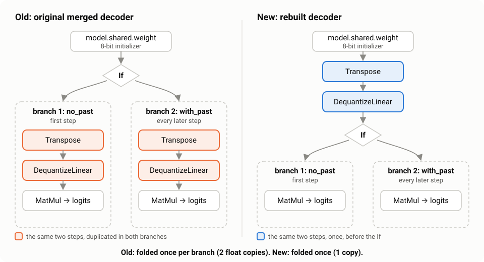

# OptimaMT

    

**ONNX Runtime's fast mode at half the memory: 2.3–2.5× faster than the default, same translations.**

ONNX Runtime decodes these OPUS-MT models 2.3–2.5× faster with `disable_quant_qdq = 1`, but the original
int8 exports pay for it with a second float copy of the output layer. OptimaMT removes that copy.

| | Linux | Windows |
|---|---:|---:|
| Decoder time per step: defaults → fast mode | 17.3 → 6.9 ms | 21.3 → 9.1 ms |
| Memory in fast mode: original → OptimaMT | 525 → 281 MiB | 500 → 257 MiB |
| Memory with defaults: original → OptimaMT | 277 → 217 MiB | 196 → 166 MiB |

Medians over 49 pairs (memory) and 5 reference pairs (time).

- **Same translations:** FLORES-200 devtest, 49 pairs × 2 settings × 1012 sentences: identical output in 98 of 98 runs, identical BLEU and chrF in 98 of 98.
- **In the browser** (transformers.js, onnxruntime-web): fast mode 1288 → 1050 MiB after load (-18 %); defaults 739 → 803 MiB (no saving after load); fast mode 1.3× faster; identical tokens.

Interactive results and a live demo:
[OptimaMT/results](https://huggingface.co/spaces/OptimaMT/results) · method: [REPORT.md](REPORT.md)



## Used in production

- [OpenCircle](https://github.com/AmerAlreyahi/OpenCircle), a desktop screen translator for Windows and Linux, ships these models since v0.1.4.

## Quick start

```js
import { pipeline } from "@huggingface/transformers";

const translator = await pipeline("translation", "OptimaMT/de-en", {
  dtype: "q8",
  session_options: { extra: { session: { disable_quant_qdq: "1" } } }, // fast mode
});
const [out] = await translator("Der Leuchtturm steht an der Küste.");
console.log(out.translation_text); // The lighthouse is on the coast.
```

```bash
pip install onnxruntime sentencepiece numpy huggingface_hub
python scripts/translate.py OptimaMT/de-en "Der Leuchtturm steht an der Küste."
```

## Verify it yourself

```bash
pip install -r requirements.txt
python scripts/convert.py en-ar   # rebuilds the decoder from Xenova's file: byte-identical to ours
python scripts/verify.py en-ar    # same token ids as the original, both session settings
```

## Models

All 49 repos: [the OptimaMT collection](https://huggingface.co/collections/OptimaMT/optimamt-lighter-opus-mt-onnx-models-6af228dc9cd91f015e56e869), named `OptimaMT/<source>-<target>`.

| From | To |
|---|---|
| en | [ar](https://huggingface.co/OptimaMT/en-ar) · [de](https://huggingface.co/OptimaMT/en-de) · [es](https://huggingface.co/OptimaMT/en-es) · [fr](https://huggingface.co/OptimaMT/en-fr) · [hi](https://huggingface.co/OptimaMT/en-hi) · [id](https://huggingface.co/OptimaMT/en-id) · [it](https://huggingface.co/OptimaMT/en-it) · [nl](https://huggingface.co/OptimaMT/en-nl) · [ru](https://huggingface.co/OptimaMT/en-ru) · [uk](https://huggingface.co/OptimaMT/en-uk) · [vi](https://huggingface.co/OptimaMT/en-vi) · [zh](https://huggingface.co/OptimaMT/en-zh) |
| es | [ar](https://huggingface.co/OptimaMT/es-ar) · [de](https://huggingface.co/OptimaMT/es-de) · [en](https://huggingface.co/OptimaMT/es-en) · [fr](https://huggingface.co/OptimaMT/es-fr) · [it](https://huggingface.co/OptimaMT/es-it) · [ru](https://huggingface.co/OptimaMT/es-ru) |
| fr | [ar](https://huggingface.co/OptimaMT/fr-ar) · [de](https://huggingface.co/OptimaMT/fr-de) · [en](https://huggingface.co/OptimaMT/fr-en) · [es](https://huggingface.co/OptimaMT/fr-es) · [ru](https://huggingface.co/OptimaMT/fr-ru) |
| ar | [de](https://huggingface.co/OptimaMT/ar-de) · [en](https://huggingface.co/OptimaMT/ar-en) · [es](https://huggingface.co/OptimaMT/ar-es) · [fr](https://huggingface.co/OptimaMT/ar-fr) |
| ru | [en](https://huggingface.co/OptimaMT/ru-en) · [es](https://huggingface.co/OptimaMT/ru-es) · [fr](https://huggingface.co/OptimaMT/ru-fr) · [uk](https://huggingface.co/OptimaMT/ru-uk) |
| de | [en](https://huggingface.co/OptimaMT/de-en) · [es](https://huggingface.co/OptimaMT/de-es) · [fr](https://huggingface.co/OptimaMT/de-fr) |
| it | [en](https://huggingface.co/OptimaMT/it-en) · [es](https://huggingface.co/OptimaMT/it-es) · [fr](https://huggingface.co/OptimaMT/it-fr) |
| nl | [en](https://huggingface.co/OptimaMT/nl-en) · [fr](https://huggingface.co/OptimaMT/nl-fr) |
| uk | [en](https://huggingface.co/OptimaMT/uk-en) · [ru](https://huggingface.co/OptimaMT/uk-ru) |
| [zh](https://huggingface.co/OptimaMT/zh-en) · [ja](https://huggingface.co/OptimaMT/ja-en) · [pl](https://huggingface.co/OptimaMT/pl-en) · [hi](https://huggingface.co/OptimaMT/hi-en) · [id](https://huggingface.co/OptimaMT/id-en) · [vi](https://huggingface.co/OptimaMT/vi-en) · [th](https://huggingface.co/OptimaMT/th-en) · [ko](https://huggingface.co/OptimaMT/ko-en) | en |

en-ar, en-zh, fr-ar and es-ar take a target token first (`>>ara<<`, `>>cmn_Hans<<`); use transformers.js 3.x for these.

## Licence

Models: OPUS-MT (University of Helsinki), ONNX exports by Xenova, modified; CC BY 4.0 ([NOTICE](NOTICE)).
Code: MIT ([LICENSE](LICENSE)).
