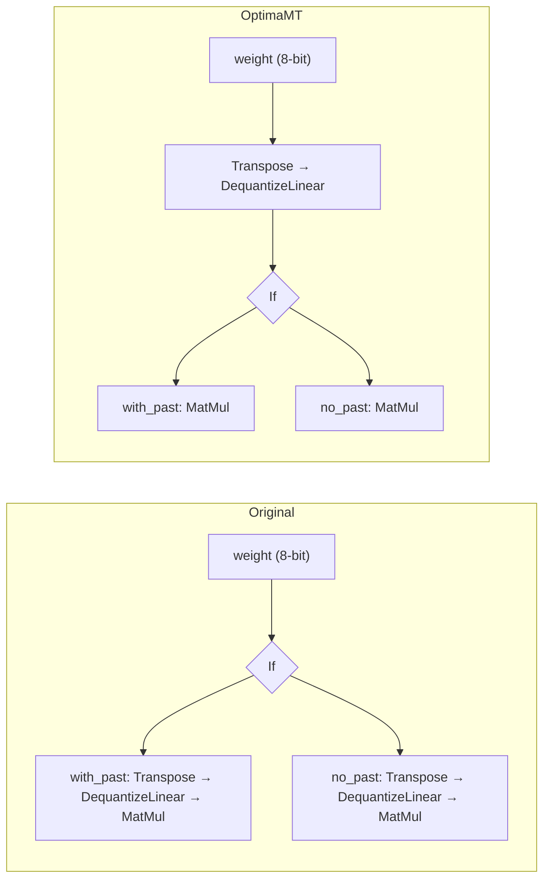
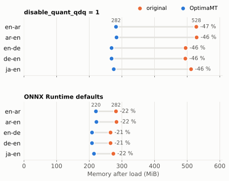
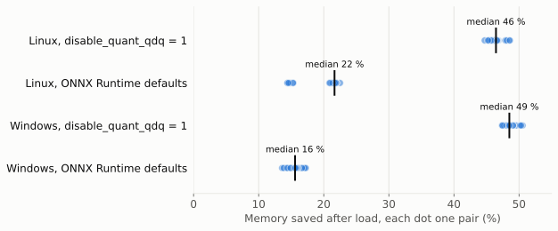

# OptimaMT: technical report

All numbers come from the scripts in this repository; raw data in [results/](results/), interactive view at
[OptimaMT/results](https://huggingface.co/spaces/OptimaMT/results).

## Summary

| | Result |
|---|---|
| Change | Output projection (`Transpose` → `DequantizeLinear`) moved out of the merged decoder's two branches, in front of the `If` |
| Pairs | 49 |
| Identical tokens | 98 / 98 runs (9,800 tokens; every pair, both session settings) |
| Memory after load, `disable_quant_qdq = 1`, Linux | 525 → 281 MiB (median), 45–49 % less |
| Memory after load, defaults, Linux | 277 → 217 MiB (median), 14–22 % less |
| Memory after load, `disable_quant_qdq = 1`, Windows | 500 → 257 MiB (median), 47–51 % less |
| Memory after load, defaults, Windows | 196 → 166 MiB (median), 14–17 % less |
| Decoder speed (Linux) | unchanged: 6.9 → 6.9 ms/step (qdq off), 17.3 → 17.3 ms/step (defaults) |

`disable_quant_qdq = 1` decodes 2.5× faster than the defaults on Linux, 2.3× on Windows. With OptimaMT it
needs about the memory the original needs with the defaults (Linux: 275 vs 274 MiB).

## 1. The finding

The merged decoder (Hugging Face Optimum) is one `If` node on `use_cache_branch`: branch `with_past` runs the first step,
`no_past` the later ones. Each branch builds the same output projection from the same initializer
(en-ar shown):

| Node | Inputs | Output |
|---|---|---|
| `Transpose` | `model.shared.weight_merged_0_quantized` (uint8 [62802, 512] (30.7 MiB)) | `model.shared.weight_transposed_quantized` |
| `DequantizeLinear` | `model.shared.weight_transposed_quantized`, `model.shared.weight_merged_0_scale`, `model.shared.weight_merged_0_zero_point` | `model.shared.weight_transposed` |
| `MatMul` | decoder state, `model.shared.weight_transposed` | logits |

ONNX Runtime folds constant nodes at load, inside the subgraph where they live. What it keeps
(`SessionOptions.optimized_model_filepath`, [scripts/inspect_graph.py](scripts/inspect_graph.py)):

| Decoder | After ONNX Runtime's optimizations, defaults | With `disable_quant_qdq = 1` |
|---|---|---|
| original | main: `model.shared.weight_merged_0_quantized` uint8 30.7 MiB with_past: `model.shared.weight_transposed_quantized` uint8 30.7 MiB no_past: `model.shared.weight_transposed_quantized` uint8 30.7 MiB | main: `model.shared.weight_merged_0_quantized` uint8 30.7 MiB with_past: `model.shared.weight_transposed` float 122.7 MiB no_past: `model.shared.weight_transposed` float 122.7 MiB |
| rebuilt | main: `model.shared.weight_merged_0_quantized` uint8 30.7 MiB main: `model.shared.weight_transposed_quantized` uint8 30.7 MiB | main: `model.shared.weight_merged_0_quantized` uint8 30.7 MiB main: `model.shared.weight_transposed` float 122.7 MiB |

- `disable_quant_qdq = 1`: the dequantized float matrix is folded once per branch: two copies in the original,
  one in OptimaMT.
- Defaults: the `DequantizeLinear` stays; the transposed 8-bit matrix is folded per branch: two copies vs one.
- This is constant folding of a duplicated subgraph, not `MatMulInteger` pre-packing.

## 2. Method

| Step | Script | What it does |
|---|---|---|
| Rebuild | [convert.py](scripts/convert.py) | Moves the two nodes before the `If`, checks both branches built the same value, runs `onnx.checker`. Output is byte-identical to the published files. |
| Identical output | [verify.py](scripts/verify.py) | Greedy decoding of [fixed sentences](data/sentences.json), original vs rebuilt, token by token, both settings. |
| Memory, speed | [measure.py](scripts/measure.py) | One fresh process per configuration; CPU, 4 threads, defaults or `disable_quant_qdq = 1`. |

Measurements:

- **After load:** RSS after creating both sessions minus RSS just before.
- **Peak:** highest RSS on a 20-line batch (`VmHWM`, reset via `/proc/self/clear_refs`).
- **ms/step:** decoder time per generated position, median of 5 runs after a warm-up.
- **Linux:** Intel(R) Core(TM) Ultra 7 265KF, 20 logical CPUs, 31.1 GB, Linux-6.6.87.2-microsoft-standard-WSL2-x86_64-with-glibc2.39, Python 3.12.3, ONNX Runtime 1.31.1.
- **Windows:** virtual machine (Intel(R) Core(TM) Ultra 7 265KF), 4 logical CPUs, 8.0 GB, Windows-10-10.0.19045-SP0, Python 3.12.12,
  ONNX Runtime 1.31.1. Memory is the working set; peaks are sampled every 2 ms.

## 3. Results

### Linux, reference pairs (en-ar, ar-en, en-de, de-en, ja-en)

| Pair | Settings | After load (MiB) | Peak, 20 lines (MiB) | ms/step | Identical |
|---|---|---:|---:|---:|---|
| en-ar | ONNX Runtime defaults | 282 → 220 (-22 %) | 529 → 476 | 17.2 → 17.3 | yes |
| en-ar | `disable_quant_qdq = 1` | 528 → 282 (-47 %) | 605 → 358 | 7.2 → 6.8 | yes |
| ar-en | ONNX Runtime defaults | 283 → 222 (-22 %) | 530 → 479 | 18.7 → 17.2 | yes |
| ar-en | `disable_quant_qdq = 1` | 529 → 284 (-46 %) | 595 → 349 | 7.8 → 7.1 | yes |
| en-de | ONNX Runtime defaults | 265 → 208 (-21 %) | 520 → 445 | 17.4 → 17.4 | yes |
| en-de | `disable_quant_qdq = 1` | 495 → 268 (-46 %) | 561 → 333 | 6.8 → 6.9 | yes |
| de-en | ONNX Runtime defaults | 265 → 208 (-21 %) | 520 → 437 | 17.3 → 15.1 | yes |
| de-en | `disable_quant_qdq = 1` | 494 → 268 (-46 %) | 547 → 321 | 6.9 → 6.9 | yes |
| ja-en | ONNX Runtime defaults | 274 → 214 (-22 %) | 531 → 464 | 15.7 → 18.3 | yes |
| ja-en | `disable_quant_qdq = 1` | 512 → 275 (-46 %) | 579 → 342 | 6.7 → 7.4 | yes |

The load peak barely moves with `disable_quant_qdq = 1` (median 630 → 511 MiB):
folding briefly holds intermediate copies either way. The batch peak drops -41 %.

### Windows

| Pair | Settings | After load (MiB) | Peak, 20 lines (MiB) | ms/step | Identical |
|---|---|---:|---:|---:|---|
| en-ar | ONNX Runtime defaults | 196 → 166 (-15 %) | 397 → 368 | 22.1 → 21.2 | yes |
| en-ar | `disable_quant_qdq = 1` | 503 → 259 (-49 %) | 583 → 339 | 9.8 → 10.2 | yes |
| ar-en | ONNX Runtime defaults | 196 → 166 (-15 %) | 390 → 365 | 22.9 → 22.6 | yes |
| ar-en | `disable_quant_qdq = 1` | 504 → 258 (-49 %) | 573 → 327 | 9.8 → 10.6 | yes |
| en-de | ONNX Runtime defaults | 187 → 159 (-15 %) | 469 → 346 | 21.3 → 19.3 | yes |
| en-de | `disable_quant_qdq = 1` | 473 → 244 (-48 %) | 541 → 313 | 8.8 → 8.5 | yes |
| de-en | ONNX Runtime defaults | 190 → 158 (-17 %) | 466 → 338 | 20.9 → 19.9 | yes |
| de-en | `disable_quant_qdq = 1` | 472 → 245 (-48 %) | 527 → 300 | 9.2 → 9.1 | yes |
| ja-en | ONNX Runtime defaults | 194 → 165 (-15 %) | 483 → 363 | 21.3 → 20.2 | yes |
| ja-en | `disable_quant_qdq = 1` | 489 → 251 (-49 %) | 560 → 322 | 8.8 → 8.9 | yes |

All 49 pairs: 47–51 % less with `disable_quant_qdq = 1`, 14–17 %
less with the defaults ([results/memory_all_windows.csv](results/memory_all_windows.csv)). The token ids on the
reference batch are the same on Windows and Linux (`ids_md5` in the reference files).

### ONNX Runtime versions

| ONNX Runtime | Session options | Original (MiB) | Rebuilt (MiB) | Change | ms/step, rebuilt | Identical tokens |
|---|---|---:|---:|---:|---:|---|
| 1.28.0 | ONNX Runtime defaults | 275 | 216 | -59 (-22 %) | 16.3 | yes |
| 1.28.0 | `disable_quant_qdq = 1` | 394 | 275 | -119 (-30 %) | 7.1 | yes |
| 1.31.1 | ONNX Runtime defaults | 274 | 214 | -60 (-22 %) | 17.3 | yes |
| 1.31.1 | `disable_quant_qdq = 1` | 512 | 275 | -237 (-46 %) | 6.9 | yes |

With 1.31 the RSS saved is about twice the folded matrix; with 1.28 about once. We did not trace which
buffers ONNX Runtime keeps.

### All pairs

Table: all 49 pairs

| Pair | Vocabulary | Defaults (MiB) | qdq off (MiB) | Identical | Model |
|---|---:|---:|---:|---|---|
| en-ar | 62,802 | 282 → 220 (-22 %) | 527 → 282 (-46 %) | yes | [OptimaMT/en-ar](https://huggingface.co/OptimaMT/en-ar) |
| en-fr | 59,514 | 270 → 212 (-21 %) | 504 → 272 (-46 %) | yes | [OptimaMT/en-fr](https://huggingface.co/OptimaMT/en-fr) |
| en-es | 65,001 | 291 → 227 (-22 %) | 545 → 291 (-47 %) | yes | [OptimaMT/en-es](https://huggingface.co/OptimaMT/en-es) |
| en-de | 58,101 | 265 → 208 (-21 %) | 495 → 269 (-46 %) | yes | [OptimaMT/en-de](https://huggingface.co/OptimaMT/en-de) |
| en-ru | 62,518 | 281 → 220 (-22 %) | 525 → 281 (-46 %) | yes | [OptimaMT/en-ru](https://huggingface.co/OptimaMT/en-ru) |
| en-zh | 65,001 | 291 → 227 (-22 %) | 545 → 291 (-47 %) | yes | [OptimaMT/en-zh](https://huggingface.co/OptimaMT/en-zh) |
| ar-en | 62,834 | 283 → 222 (-22 %) | 529 → 284 (-46 %) | yes | [OptimaMT/ar-en](https://huggingface.co/OptimaMT/ar-en) |
| fr-en | 59,514 | 270 → 212 (-22 %) | 505 → 272 (-46 %) | yes | [OptimaMT/fr-en](https://huggingface.co/OptimaMT/fr-en) |
| zh-en | 65,001 | 290 → 226 (-22 %) | 544 → 290 (-47 %) | yes | [OptimaMT/zh-en](https://huggingface.co/OptimaMT/zh-en) |
| ja-en | 60,716 | 274 → 214 (-22 %) | 513 → 276 (-46 %) | yes | [OptimaMT/ja-en](https://huggingface.co/OptimaMT/ja-en) |
| es-en | 65,001 | 290 → 227 (-22 %) | 544 → 290 (-47 %) | yes | [OptimaMT/es-en](https://huggingface.co/OptimaMT/es-en) |
| de-en | 58,101 | 265 → 208 (-21 %) | 495 → 268 (-46 %) | yes | [OptimaMT/de-en](https://huggingface.co/OptimaMT/de-en) |
| ru-en | 62,518 | 281 → 220 (-22 %) | 527 → 282 (-47 %) | yes | [OptimaMT/ru-en](https://huggingface.co/OptimaMT/ru-en) |
| it-en | 80,379 | 255 → 216 (-15 %) | 648 → 333 (-49 %) | yes | [OptimaMT/it-en](https://huggingface.co/OptimaMT/it-en) |
| nl-en | 67,028 | 233 → 199 (-15 %) | 558 → 297 (-47 %) | yes | [OptimaMT/nl-en](https://huggingface.co/OptimaMT/nl-en) |
| uk-en | 61,587 | 278 → 218 (-22 %) | 520 → 279 (-46 %) | yes | [OptimaMT/uk-en](https://huggingface.co/OptimaMT/uk-en) |
| pl-en | 63,430 | 285 → 224 (-22 %) | 534 → 286 (-46 %) | yes | [OptimaMT/pl-en](https://huggingface.co/OptimaMT/pl-en) |
| hi-en | 61,127 | 277 → 217 (-22 %) | 518 → 278 (-46 %) | yes | [OptimaMT/hi-en](https://huggingface.co/OptimaMT/hi-en) |
| id-en | 54,796 | 254 → 201 (-21 %) | 472 → 258 (-45 %) | yes | [OptimaMT/id-en](https://huggingface.co/OptimaMT/id-en) |
| vi-en | 53,739 | 251 → 198 (-21 %) | 465 → 255 (-45 %) | yes | [OptimaMT/vi-en](https://huggingface.co/OptimaMT/vi-en) |
| th-en | 62,307 | 280 → 219 (-22 %) | 524 → 280 (-47 %) | yes | [OptimaMT/th-en](https://huggingface.co/OptimaMT/th-en) |
| ko-en | 65,001 | 291 → 228 (-22 %) | 545 → 291 (-47 %) | yes | [OptimaMT/ko-en](https://huggingface.co/OptimaMT/ko-en) |
| en-it | 80,035 | 255 → 216 (-15 %) | 645 → 333 (-48 %) | yes | [OptimaMT/en-it](https://huggingface.co/OptimaMT/en-it) |
| en-nl | 67,028 | 230 → 197 (-14 %) | 557 → 296 (-47 %) | yes | [OptimaMT/en-nl](https://huggingface.co/OptimaMT/en-nl) |
| en-uk | 61,587 | 277 → 217 (-22 %) | 519 → 279 (-46 %) | yes | [OptimaMT/en-uk](https://huggingface.co/OptimaMT/en-uk) |
| en-hi | 61,950 | 279 → 218 (-22 %) | 522 → 279 (-47 %) | yes | [OptimaMT/en-hi](https://huggingface.co/OptimaMT/en-hi) |
| en-id | 54,796 | 254 → 201 (-21 %) | 472 → 257 (-46 %) | yes | [OptimaMT/en-id](https://huggingface.co/OptimaMT/en-id) |
| en-vi | 53,685 | 251 → 198 (-21 %) | 464 → 257 (-45 %) | yes | [OptimaMT/en-vi](https://huggingface.co/OptimaMT/en-vi) |
| de-es | 61,301 | 277 → 217 (-22 %) | 516 → 278 (-46 %) | yes | [OptimaMT/de-es](https://huggingface.co/OptimaMT/de-es) |
| de-fr | 61,153 | 276 → 217 (-22 %) | 516 → 277 (-46 %) | yes | [OptimaMT/de-fr](https://huggingface.co/OptimaMT/de-fr) |
| es-de | 61,301 | 276 → 216 (-22 %) | 516 → 277 (-46 %) | yes | [OptimaMT/es-de](https://huggingface.co/OptimaMT/es-de) |
| es-fr | 74,822 | 244 → 208 (-15 %) | 610 → 318 (-48 %) | yes | [OptimaMT/es-fr](https://huggingface.co/OptimaMT/es-fr) |
| es-it | 59,031 | 269 → 211 (-21 %) | 501 → 270 (-46 %) | yes | [OptimaMT/es-it](https://huggingface.co/OptimaMT/es-it) |
| es-ru | 63,430 | 284 → 222 (-22 %) | 532 → 284 (-47 %) | yes | [OptimaMT/es-ru](https://huggingface.co/OptimaMT/es-ru) |
| fr-de | 61,153 | 276 → 216 (-22 %) | 516 → 276 (-46 %) | yes | [OptimaMT/fr-de](https://huggingface.co/OptimaMT/fr-de) |
| fr-es | 74,822 | 243 → 208 (-14 %) | 610 → 316 (-48 %) | yes | [OptimaMT/fr-es](https://huggingface.co/OptimaMT/fr-es) |
| fr-ru | 64,377 | 287 → 224 (-22 %) | 539 → 287 (-47 %) | yes | [OptimaMT/fr-ru](https://huggingface.co/OptimaMT/fr-ru) |
| it-es | 59,031 | 269 → 211 (-21 %) | 501 → 271 (-46 %) | yes | [OptimaMT/it-es](https://huggingface.co/OptimaMT/it-es) |
| it-fr | 59,351 | 270 → 212 (-21 %) | 503 → 272 (-46 %) | yes | [OptimaMT/it-fr](https://huggingface.co/OptimaMT/it-fr) |
| ru-es | 63,430 | 284 → 222 (-22 %) | 533 → 285 (-47 %) | yes | [OptimaMT/ru-es](https://huggingface.co/OptimaMT/ru-es) |
| ru-fr | 64,377 | 287 → 224 (-22 %) | 540 → 288 (-47 %) | yes | [OptimaMT/ru-fr](https://huggingface.co/OptimaMT/ru-fr) |
| ru-uk | 57,777 | 265 → 208 (-21 %) | 494 → 268 (-46 %) | yes | [OptimaMT/ru-uk](https://huggingface.co/OptimaMT/ru-uk) |
| uk-ru | 57,777 | 265 → 208 (-21 %) | 494 → 268 (-46 %) | yes | [OptimaMT/uk-ru](https://huggingface.co/OptimaMT/uk-ru) |
| nl-fr | 57,642 | 266 → 210 (-21 %) | 494 → 270 (-45 %) | yes | [OptimaMT/nl-fr](https://huggingface.co/OptimaMT/nl-fr) |
| fr-ar | 62,419 | 281 → 220 (-22 %) | 525 → 281 (-47 %) | yes | [OptimaMT/fr-ar](https://huggingface.co/OptimaMT/fr-ar) |
| es-ar | 62,518 | 281 → 220 (-22 %) | 526 → 282 (-46 %) | yes | [OptimaMT/es-ar](https://huggingface.co/OptimaMT/es-ar) |
| ar-fr | 64,505 | 288 → 226 (-22 %) | 542 → 290 (-47 %) | yes | [OptimaMT/ar-fr](https://huggingface.co/OptimaMT/ar-fr) |
| ar-es | 62,526 | 281 → 220 (-22 %) | 526 → 281 (-47 %) | yes | [OptimaMT/ar-es](https://huggingface.co/OptimaMT/ar-es) |
| ar-de | 63,079 | 283 → 221 (-22 %) | 530 → 283 (-47 %) | yes | [OptimaMT/ar-de](https://huggingface.co/OptimaMT/ar-de) |

### Drop-in check

[tests/dropin_test.py](tests/dropin_test.py): local folders vs the original files (and the Xenova Hub repos at
their pinned revisions), with transformers.js 3.8.1 and 4.3.2 and ONNX Runtime Python.

| transformers.js | Pair | Same as original (defaults / qdq off) | Python same | Node RSS, defaults (MiB) | Node RSS, qdq off (MiB) |
|---|---|---|---|---:|---:|
| 3.8.1 | en-ar | yes / yes | yes | 466 → 400 | 736 → 612 |
| 3.8.1 | de-en | yes / yes | yes | 446 → 397 | 692 → 578 |
| 3.8.1 | ja-en | yes / yes | yes | 524 → 402 | 715 → 604 |
| 3.8.1 | ar-de | yes / yes | yes | 495 → 416 | 754 → 632 |
| 4.3.2 | en-ar | yes / yes | yes | 452 → 400 | 709 → 462 |
| 4.3.2 | de-en | yes / yes | yes | 444 → 387 | 664 → 431 |
| 4.3.2 | ja-en | yes / yes | yes | 448 → 390 | 698 → 454 |
| 4.3.2 | ar-de | yes / yes | yes | 471 → 405 | 708 → 465 |

- transformers.js 4.3.2 splits target tokens such as `>>ara<<` (the original exports too); 3.8.1 does not.
- transformers.js tokenizes with `tokenizer.json`, the Python script with `source.spm`; outputs can differ
  between the two (ja-en), never between original and OptimaMT.

## 4. Limitations

- CPU only; greedy decoding only; one host (Linux directly, Windows in a virtual machine).
- RSS includes allocator effects (a few MiB of noise); the saving depends on the ONNX Runtime version.
- Quality is the original models' (identical tokens on the test set); no corpus-level evaluation.
- Token ids can differ between ONNX Runtime versions, for both decoders alike.

## 5. Licences

OPUS-MT (University of Helsinki) and the Xenova exports: CC BY 4.0. Five pairs (fr-ar, es-ar, ar-fr, ar-es,
ar-de) were exported from the Helsinki-NLP weights in the same layout. Modified files: CC BY 4.0
([NOTICE](NOTICE)). Code: MIT ([LICENSE](LICENSE)).
